# Google Play listing

Everything to paste into Play Console for the first release, in English (default) and Greek. Character counts are checked against Play's limits by the snippet at the end of this file.

- **Package:** `com.hullbreach.leviathan` (this can never change after the first upload)
- **Default language:** English (United States), en-US, with a Greek (el-GR) translation
- **App or game:** Game. **Category:** Adventure
- **Free or paid:** Free. A free app can never become paid later.
- **Contact email:** kitsorfan@protonmail.com (shown publicly on the store page)
- **Privacy policy URL:** https://github.com/kitsorfan/ArgonautsOfTheGalaxy/blob/master/docs/privacy-policy.md (see [Hosting the privacy policy](#hosting-the-privacy-policy))

## Graphics

| Asset | Play's requirement | File |
| --- | --- | --- |
| App icon | 512 × 512 PNG | [icon-512.png](icon-512.png) |
| Feature graphic | 1024 × 500 JPEG or PNG | [en/feature-graphic.jpg](en/feature-graphic.jpg), [el/feature-graphic.jpg](el/feature-graphic.jpg) |
| Phone screenshots | 2 to 8, 16:9, at least 1080 px | `en/01` to `en/08`, `el/01` to `el/08` (1920 × 1080) |

Upload the screenshots in file order. Play shows the first three most, so they're gameplay:

| # | English | Greek |
| --- | --- | --- |
| 1 | 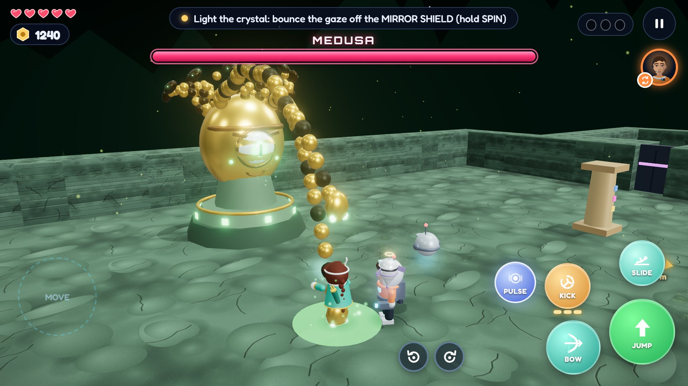 | 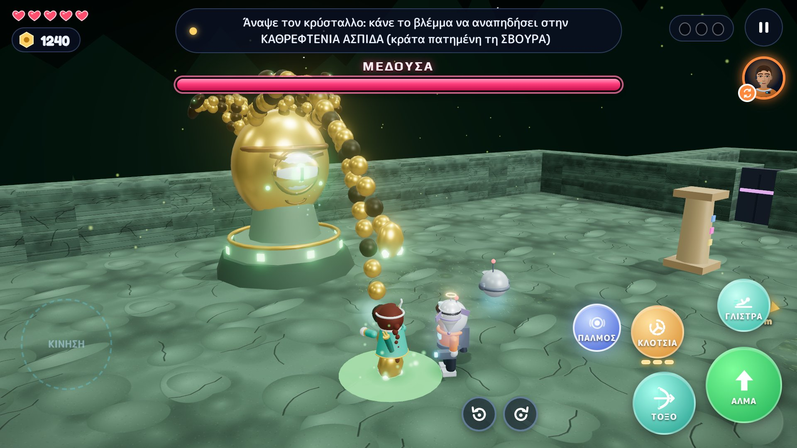 |
| 2 | 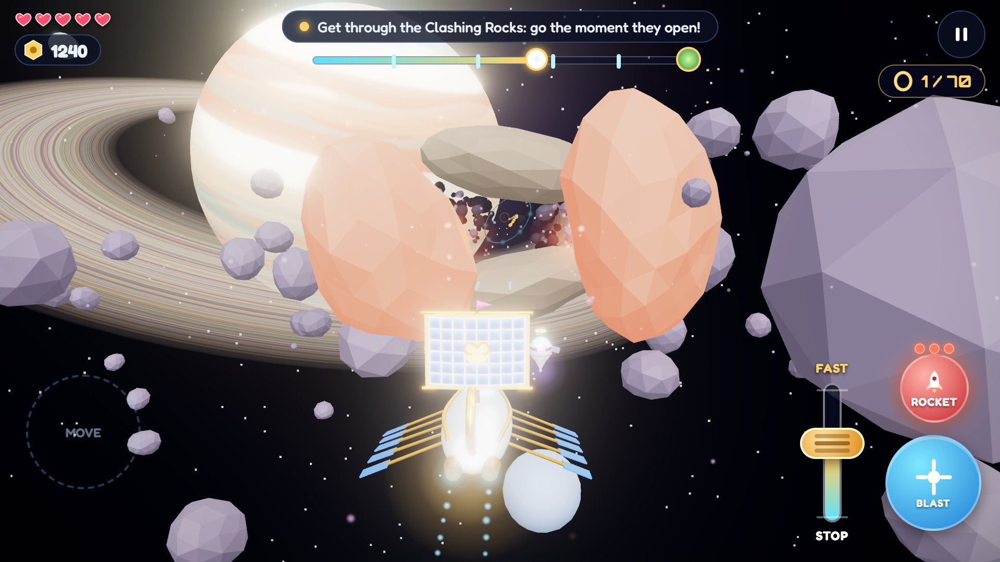 |  |
| 3 | 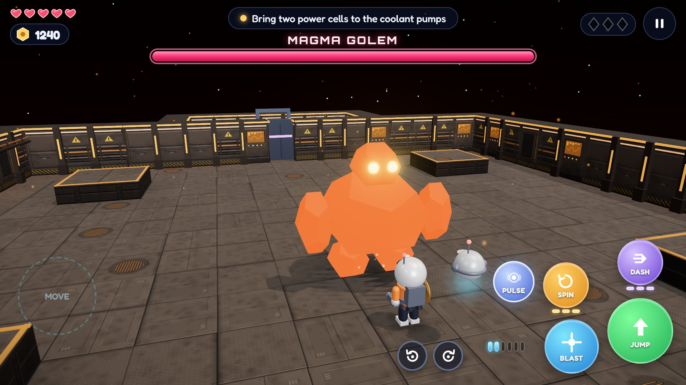 |  |
| 4 | 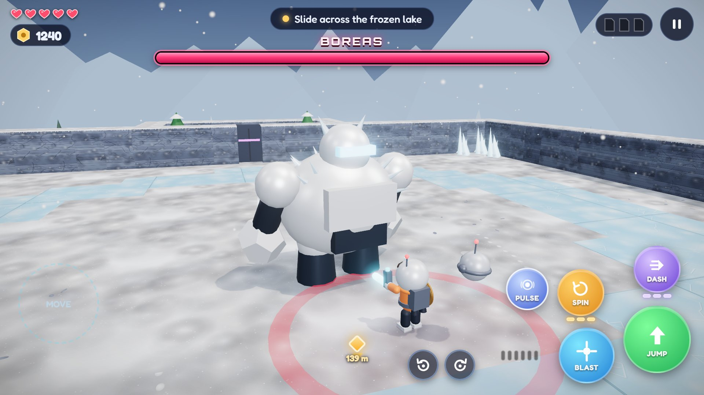 | 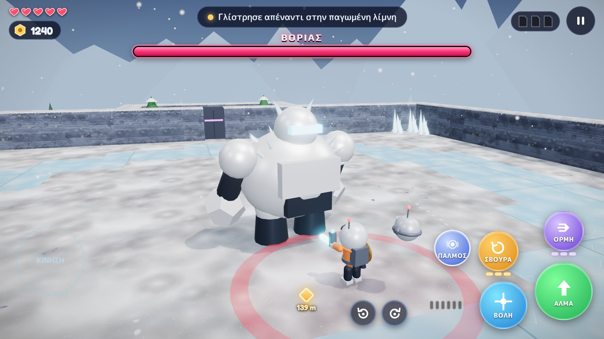 |
| 5 | 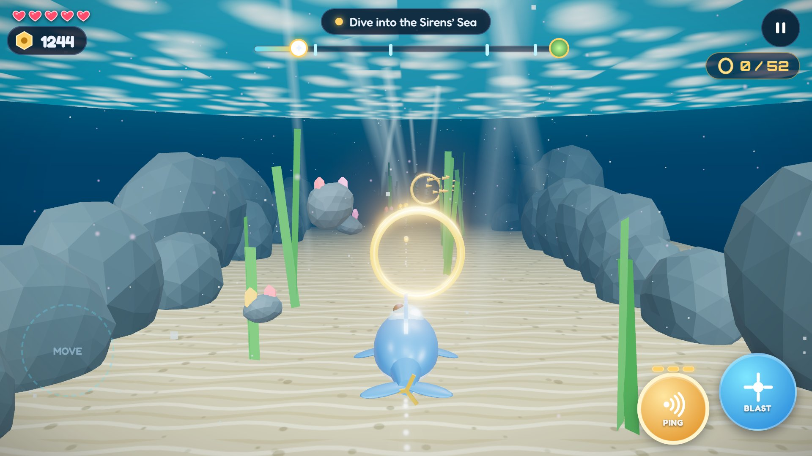 | 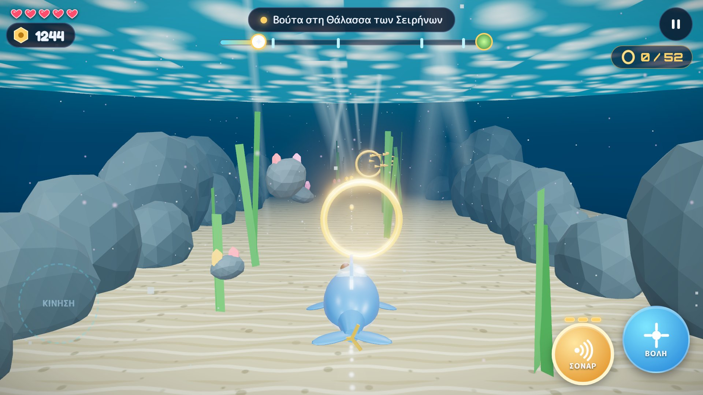 |
| 6 | 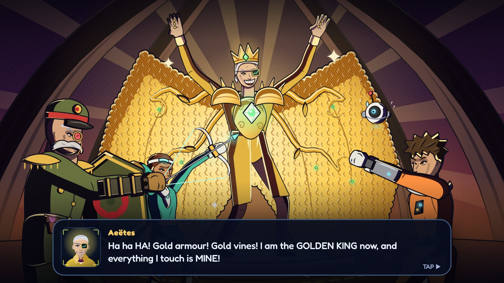 | 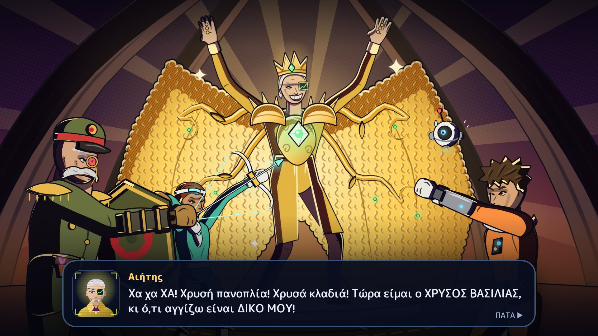 |
| 7 | 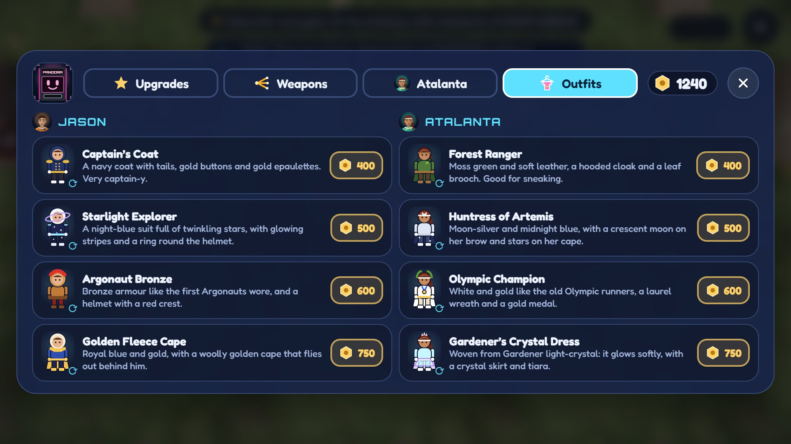 | 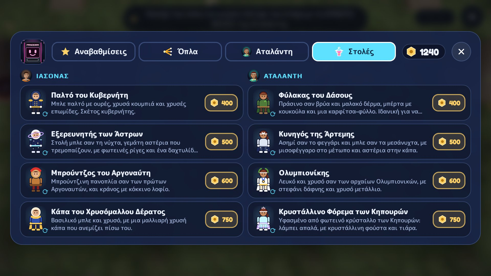 |
| 8 | 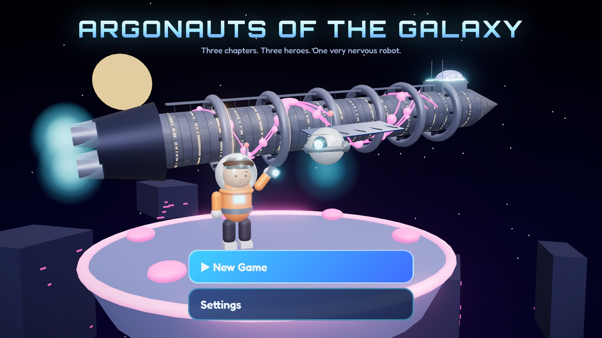 | 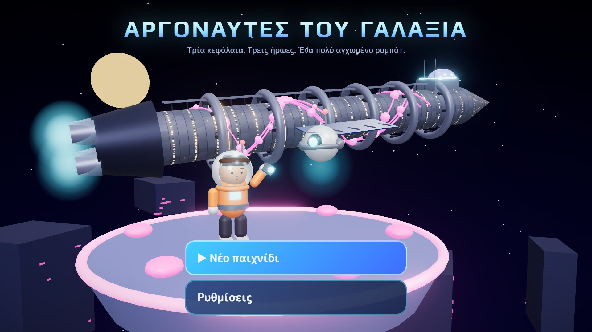 |

They cover all three chapters: Medusa (Chapter 3), the Argo in the Clashing Rocks, the Magma Golem (Chapter 1), BOREAS (Chapter 2), the submarine, a story picture, PANDORA's shop and the title screen. They were taken from the real game in headless Edge at 960 × 540, drawn at 2× (a phone in landscape), on the trailer tool's frozen clock, so the English and Greek shots match frame for frame. To retake them after the game's look changes: `npm run game:build`, copy `game/dist/index.html` into an empty folder, then `bash game/tools/storeshots/run.sh <that folder> docs/store` (needs Edge and ffmpeg, about a minute). The shot list, with each frame and camera, is `game/tools/storeshots/shots.mjs`.

## English (en-US)

**App name** (30 max)

```text
Argonauts of the Galaxy
```

**Short description** (80 max)

```text
Three chapters. Three heroes. One very nervous robot. A bright 3D adventure.
```

**Full description** (4000 max)

```text
A glowing space vine has grown over every deck of the colony ship Syracusia, and it is steering ten thousand sleeping colonists straight toward a star. And that is only the beginning.

You are Jason, a junior engineer who wakes up early. With LUX, a little repair drone who is scared of the dark, you will climb a starship overrun by vines, free a whole planet from General Brennus and his machines, and sail with the Argonauts to win the Golden Fleece.

THREE CHAPTERS, 22 LEVELS
Chapter 1, the Syracusia: six decks, from frozen cryo bays and a lava-filled engine core up to the Bridge.
Chapter 2, Gaia Nova: six wild regions of a new planet, from golden plains and a glass desert to a blizzard, a grey jungle and a fortress inside a volcano.
Chapter 3, the Argonauts: ten levels of Greek myth in space. The Clashing Rocks, the Harpy Isles, the Sirens' Sea, Scylla's Reef, Talos's forge, Medusa's labyrinth, the garden of the Sleepless Dragon and the Golden Fleece itself.

THREE HEROES AND SOME BIG MACHINES
Play as Jason, as Atalanta, the colony's fastest runner and best archer, and even as General Brennus with his shield and his robot legion. Switch heroes to solve puzzles together. Fly the Argo between slamming rocks, dive the little submarine Dolphin, and stomp around in a bronze mech with a flamethrower.

BLAST, SPIN, DASH, GRAPPLE
Tap to shoot, or hold to charge a fireball. Spin to knock enemy shots back at them. Find Jet Boots, Dash Thrusters, a Hover Pack, a grapple hook and a Mirror Shield, and each one opens new paths.

BOSSES TO REMEMBER
The Magma Golem, CERBERUS, BOREAS, the Colossus, MEDUSA, TALOS, the Golden Ram, a dragon you have to sing to sleep, and Aeëtes, the Golden King. And one boss you really won't want to fight: LUX himself.

SECRETS FOR EXPLORERS
Free trapped colonists and scientists, find hidden hearts, crack secret vaults, and collect every memory shard, journal page and light-stone to unlock each chapter's secret ending.

PANDORA'S SHOP
Spend the bolts you collect on extra hearts, a stronger blaster, new weapons and outfits for Jason and Atalanta.

A STORY LIKE A GRAPHIC NOVEL
Cutscenes in the game world, bosses that make an entrance with their own name cards, and the big story moments drawn as graphic-novel pictures.

MADE FOR YOUNG PLAYERS AND EVERYONE ELSE
Bright and forgiving, for players of about 9 and up. Plays fully offline. No ads and no in-app purchases. In English and Greek.

Best played in landscape, with headphones.
```

**Release notes for version 1.0.0** (500 max)

```text
The first release:
• 22 levels in three chapters: the Syracusia, Gaia Nova and the Argonauts' voyage.
• Play as Jason, Atalanta, General Brennus and a bronze mech.
• Fly the Argo and dive the submarine Dolphin.
• PANDORA's shop: upgrades, weapons and outfits.
• Side quests, secret endings and graphic-novel story pictures.
• English or Greek: switch any time in Settings.
```

## Greek (el-GR)

**App name** (30 max)

```text
Αργοναύτες του Γαλαξία
```

**Short description** (80 max)

```text
Τρία κεφάλαια. Τρεις ήρωες. Ένα πολύ αγχωμένο ρομπότ. Μια πολύχρωμη περιπέτεια.
```

**Full description** (4000 max)

```text
Ένα φωτεινό διαστημικό φυτό έχει απλωθεί σε κάθε κατάστρωμα του αποικιακού σκάφους Συρακουσία, και οδηγεί δέκα χιλιάδες κοιμισμένους αποίκους κατευθείαν σε ένα αστέρι. Κι αυτό είναι μόνο η αρχή.

Είσαι ο Ιάσονας, ένας δόκιμος μηχανικός που ξυπνά πιο νωρίς από όλους. Μαζί με τον ΛΟΥΞ, ένα μικρό ρομπότ επισκευών που φοβάται το σκοτάδι, θα ανέβεις ένα διαστημόπλοιο πνιγμένο στη βλάστηση, θα ελευθερώσεις έναν ολόκληρο πλανήτη από τον Στρατηγό Βρέννο και τις μηχανές του, και θα ταξιδέψεις με τους Αργοναύτες για το Χρυσόμαλλο Δέρας.

ΤΡΙΑ ΚΕΦΑΛΑΙΑ, 22 ΠΙΣΤΕΣ
Κεφάλαιο 1, η Συρακουσία: έξι καταστρώματα, από παγωμένους θαλάμους κρυοΰπνου και έναν πυρήνα κινητήρων γεμάτο λάβα ως τη Γέφυρα.
Κεφάλαιο 2, η Γαία Νόβα: έξι άγριες περιοχές ενός νέου πλανήτη, από χρυσές πεδιάδες και μια γυάλινη έρημο ως μια χιονοθύελλα, μια γκρίζα ζούγκλα και ένα φρούριο μέσα σε ηφαίστειο.
Κεφάλαιο 3, οι Αργοναύτες: δέκα πίστες ελληνικής μυθολογίας στο διάστημα. Οι Συμπληγάδες, τα Νησιά των Αρπυιών, η Θάλασσα των Σειρήνων, ο Ύφαλος της Σκύλλας, το Σιδηρουργείο του Τάλω, ο Λαβύρινθος της Μέδουσας, ο κήπος του Ακοίμητου Δράκου και το ίδιο το Χρυσόμαλλο Δέρας.

ΤΡΕΙΣ ΗΡΩΕΣ ΚΑΙ ΜΕΡΙΚΕΣ ΜΕΓΑΛΕΣ ΜΗΧΑΝΕΣ
Παίξε με τον Ιάσονα, με την Αταλάντη, την πιο γρήγορη δρομέα και την καλύτερη τοξότρια της αποικίας, ακόμα και με τον Στρατηγό Βρέννο, με την ασπίδα του και τη λεγεώνα των ρομπότ του. Άλλαξε ήρωα για να λύσετε γρίφους μαζί. Πέτα με την Αργώ ανάμεσα σε βράχους που συγκρούονται, βούτα με το μικρό υποβρύχιο Δελφίνι και περπάτα βαριά με μια χάλκινη ρομποστολή που έχει φλογοβόλο.

ΒΟΛΗ, ΣΒΟΥΡΑ, ΟΡΜΗ, ΓΑΝΤΖΟΣ
Πάτα για να πυροβολήσεις ή κράτα πατημένο για να γεμίσεις μια βολίδα φωτιάς. Κάνε σβούρα για να στείλεις πίσω τις βολές των εχθρών. Βρες Τζετ-Μπότες, Προωθητήρες Ορμής, Σακίδιο Αιώρησης, γάντζο και μια ασπίδα-καθρέφτη, και το καθένα ανοίγει νέους δρόμους.

ΑΝΤΙΠΑΛΟΙ ΠΟΥ ΔΕΝ ΞΕΧΝΙΟΥΝΤΑΙ
Το Γκόλεμ του Μάγματος, ο ΚΕΡΒΕΡΟΣ, ο ΒΟΡΙΑΣ, ο Κολοσσός, η ΜΕΔΟΥΣΑ, ο ΤΑΛΩΣ, το Χρυσό Κριάρι, ένας δράκος που πρέπει να τον νανουρίσεις, και ο Αιήτης, ο Χρυσός Βασιλιάς. Κι ένας αντίπαλος που δεν θα ήθελες ποτέ να αντιμετωπίσεις: ο ίδιος ο ΛΟΥΞ.

ΜΥΣΤΙΚΑ ΓΙΑ ΕΞΕΡΕΥΝΗΤΕΣ
Ελευθέρωσε παγιδευμένους αποίκους και επιστήμονες, βρες κρυμμένες καρδιές, άνοιξε κρυφά θησαυροφυλάκια και μάζεψε όλα τα θραύσματα μνήμης, τις σελίδες ημερολογίου και τις φωτόπετρες για να ξεκλειδώσεις το μυστικό τέλος κάθε κεφαλαίου.

ΤΟ ΜΑΓΑΖΙ ΤΗΣ ΠΑΝΔΩΡΑΣ
Ξόδεψε τις βίδες που μαζεύεις σε περισσότερες καρδιές, πιο δυνατό όπλο, καινούργια όπλα και στολές για τον Ιάσονα και την Αταλάντη.

ΜΙΑ ΙΣΤΟΡΙΑ ΣΑΝ ΚΟΜΙΚ
Κινηματογραφικές σκηνές μέσα στον κόσμο του παιχνιδιού, αντίπαλοι που κάνουν την είσοδό τους με το όνομά τους σε μεγάλα γράμματα, και οι μεγάλες στιγμές της ιστορίας ζωγραφισμένες σαν κόμικ.

ΓΙΑ ΜΙΚΡΟΥΣ ΚΑΙ ΜΕΓΑΛΟΥΣ
Πολύχρωμο και χωρίς άγχος, για παίκτες από 9 ετών και πάνω. Παίζεται χωρίς σύνδεση στο διαδίκτυο. Χωρίς διαφημίσεις και χωρίς αγορές μέσα στην εφαρμογή. Στα ελληνικά και στα αγγλικά.

Παίζεται καλύτερα με το κινητό οριζόντια και με ακουστικά.
```

**Release notes for version 1.0.0** (500 max)

```text
Η πρώτη κυκλοφορία:
• 22 πίστες σε τρία κεφάλαια: η Συρακουσία, η Γαία Νόβα και το ταξίδι των Αργοναυτών.
• Παίξε με τον Ιάσονα, την Αταλάντη, τον Στρατηγό Βρέννο και μια χάλκινη ρομποστολή.
• Πέτα με την Αργώ και βούτα με το υποβρύχιο Δελφίνι.
• Το μαγαζί της ΠΑΝΔΩΡΑΣ: αναβαθμίσεις, όπλα και στολές.
• Δευτερεύουσες αποστολές, μυστικά φινάλε και εικόνες σαν κόμικ.
• Αγγλικά ή Ελληνικά: άλλαξε όποτε θες από τις Ρυθμίσεις.
```

## App content answers

These are the answers for Play Console's **Policy → App content** forms, based on what the game actually does. Check them again if the game changes.

| Form | Answer |
| --- | --- |
| Privacy policy | The public URL of `docs/privacy-policy.md` |
| Ads | No, the app contains no ads |
| App access | All functionality is available without any access restrictions |
| Content rating (IARC questionnaire) | Category: Game. Violence: yes, cartoon or fantasy violence against robots and monsters, with no blood or gore and no realistic human violence. No sexual content, bad language, drugs, alcohol or gambling. No user-to-user chat or sharing, no location sharing, no digital purchases. Play gives the final rating; expect about PEGI 7 / ESRB Everyone 10+ |
| Target audience | 9 to 12, 13 to 15, 16 to 17 and 18+. Including 9 to 12 means the [Families policy](https://support.google.com/googleplay/android-developer/answer/9893335) applies, which the game already meets: no ads, no data collection, no purchases |
| Data safety | "Does your app collect or share any of the required user data types?" **No.** The save stays on the device and is never sent anywhere |
| Government app, financial features, health, news | No |

The build asks Android for only two permissions: **vibration** for haptics, and **internet**, which React Native includes by default and the game never uses. `app.json` blocks the storage and "display over other apps" permissions that Expo's Android template adds, because the game doesn't need them.

## Hosting the privacy policy

Play needs a public, non-editable web page, not a PDF. The repo is public on GitHub, so the policy's github.com page (the URL at the top of this file) is enough: it shows whatever is on `master`, so push before pasting the link into Play Console. GitHub Pages for the `docs/` folder would give a tidier address if you ever want one.

## Before you submit

1. Build the app bundle: `npx eas-cli@latest build -p android --profile production`. EAS keeps the Android `versionCode` (`appVersionSource: "remote"` in `eas.json`) and raises it on every production build, so each upload is accepted. For a local Gradle build of an upload, run `npx eas-cli@latest build:version:sync -p android` first.
2. For a personal developer account, run a closed test first: at least 12 testers, opted in for 14 days in a row. Only then can you apply for production.
3. Upload the first `.aab` by hand in Play Console. Later builds can use `eas submit`.

## Checking the character limits

Run this from the project root after editing the text above:

```bash
node -e "const t=require('fs').readFileSync('docs/store/listing.md','utf8');const b=[...t.matchAll(/\*\*(.+?)\*\* \((\d+) max\)\s+\`\`\`text\n([\s\S]*?)\n\`\`\`/g)];for(const[,n,max,s]of b)console.log((([...s].length<=+max)?'ok  ':'LONG')+' '+[...s].length+'/'+max+'  '+n)"
```
